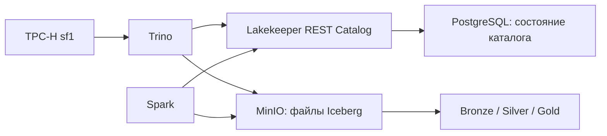

# Практическая №1: Максим Ладыгин, вариант 3

TPC-H Q18 «Large Volume Customer», локальный Lakehouse и сравнение форматов/сжатия.



**Текущий статус проверяется в [отчет.md](отчет.md) и `results/completion.json`.** Наличие кода не означает, что стенд уже запущен. Для сдачи нужны успешный полный запуск, фактические результаты и публикация репозитория в своей учётной записи GitHub.

## Запуск на Windows

1. Установить Docker Desktop с WSL 2, запустить его, выбрать Linux containers. Для данного компьютера предусмотрен sf1. В Docker/WSL должно быть достаточно памяти для Trino с heap 4 ГБ и остальных служб; желательно 8–10 ГБ для окружения Docker. Оставить Windows запас памяти.
2. Открыть PowerShell **в папке этого проекта**, где лежит `compose.yaml`.
3. Выполнить:

```powershell
powershell -NoProfile -ExecutionPolicy Bypass -File .\run.ps1 -SF 1 -Repeats 5
```

Команда временно задаёт политику исполнения только новому процессу PowerShell и не меняет системную политику. Нужен интернет для загрузки образов и двух официальных JAR Apache Iceberg. Никаких исходных данных вручную скачивать не требуется: их генерирует Trino TPC-H.

MinIO и mc собираются локально из официальных исходников по фиксированным тегам RELEASE.2025-04-22T22-12-26Z и RELEASE.2025-04-16T18-13-26Z. На 15.10.2026 указанные в учебном гайде образы Quay возвращают 401, а теги Docker Hub удалены. Поэтому в `minio/Dockerfile` используется сборка Go, а не сторонний готовый образ. Первый запуск включает загрузку Go-зависимостей и компиляцию; последующие используют кэш Docker. Стек и S3-интерфейс сохраняются.

Сценарий поднимет MinIO/PostgreSQL/Lakekeeper/Trino, создаст бакет и warehouse, построит слои, выполнит проверки, замерит семь вариантов Bronze, покажет schema evolution и восстановление. Затем остановит Trino, запустит Spark над существующим Bronze, снова запустит Trino и сформирует итоговый отчёт. Повторный полный запуск создаёт новые схемы с идентификатором UTC-времени: старые таблицы не перезаписываются, но расход диска увеличивается.

Если Docker уже запущен, установка Python, Java, Spark и Trino в Windows не нужна: всё работает в контейнерах. Службы доступны только локально:

| Сервис | Адрес | Доступ |
|---|---|---|
| MinIO UI | http://localhost:9001 | minioadmin / minioadmin |
| Trino UI | http://localhost:8080 | пользователь ladygin |
| Lakekeeper | http://localhost:8181/ui/ | локальный учебный стенд |

Учебные пароли не используются для внешних сервисов. Том PostgreSQL и том MinIO сохраняют данные. Для остановки без удаления:

```powershell
docker compose stop
```

## Результаты

- `отчет.md` повторяет разделы и таблицы преподавательской формы.
- `results/pipeline.json`: строки, точные байты data-файлов, метаданные, схемы, эталон Q18.
- `results/benchmark.json`: время записи, первый Q18, все повторные замеры, медианы, разброс, размеры и совпадение результата.
- `results/gold.csv` и `results/gold.json`: витрина с не более чем 100 заказами.
- `results/quality.json`: восемь проверок качества; все значения должны быть нулевыми.
- `results/demo.json`: идентификатор снапшота, проверка эволюции схемы и восстановленного содержимого.
- `results/spark-bronze.json`: независимое чтение Bronze и агрегация Spark.
- `results/runs/<время UTC>/`: SQL, query_id, статистика Trino и измерения каждого запроса.
- `results/environment.json`, `host.json`, `docker-ps.jsonl`, `docker-images.json`: окружение запуска.
- `results/completion.json`: все обязательные флаги должны быть true.

Публиковать в git следует код, конфигурации, отчёт и полученные доказательства. Объёмные data-файлы и тома Docker в git не входят. Логи содержат SQL и синтетические строки TPC-H, но перед публикацией всё равно просмотрите содержимое.

## Отдельные этапы и восстановление после ошибки

```powershell
# Новый Bronze/Silver/Gold без остальных экспериментов:
.\run.ps1 -Stage pipeline
# После успешного pipeline: сравнение кодеков и форматов
.\run.ps1 -Stage benchmark
# Демонстрация на текущем pipeline (один раз):
.\run.ps1 -Stage demo
# Второй движок, если все предыдущие этапы успешны:
docker compose stop trino
docker compose run --rm --build spark
docker compose start trino
# Повторное создание отчёта из результатов:
.\run.ps1 -Stage report
```

После неуспешной частичной загрузки выполните новый `pipeline` или полный запуск: он создаст новый набор схем. Старые ресурсы автоматически не удаляются. Повторять `demo` для одной схемы не следует: колонка и демонстрационная таблица уже существуют. `report` не смешивает результаты разных run: устаревшие benchmark/demo/Spark исключаются.

При ошибке: `docker compose ps -a`, `docker compose logs --tail 100 lakekeeper trino`, затем файл `FAILED.txt` в последней папке `results/runs/`. Если не хватает памяти, закройте тяжёлые приложения, проверьте лимит Docker/WSL и повторите sf1. Не снижайте объём незаметно: выбранный SF должен совпадать с отчётом и всеми слоями.

## Соответствие критериям

| Критерий | Где подтверждается |
|---|---|
| Полнота, 8 | compose, pipeline, benchmark, demo, Spark; `completion.json` |
| Обоснование решений, 5 | Разделы 1–4, 6 отчёта: SF, технологии, поля, слои, партиционирование |
| Корректность, 4 | Эталон Q18, quality gates, сравнение каждого ответа, точные байты, сырые замеры |
| Оформление и выводы, 3 | Заполненная форма отчёта, методология, ограничения и выводы по фактическим результатам |

## Публикация

После полного запуска просмотрите отчёт и убедитесь, что `completion.json` содержит `complete: true`. Репозиторий работы: [J043R/Prac1](https://github.com/J043R/Prac1). В VK Education укажите эту ссылку. Срок в предоставленном задании: **17 октября 2026, 23:59**. Отправка ссылки на проверку в VK Education выполняется отдельно от публикации в GitHub.

## Проверка кода без Docker

```powershell
python -m unittest discover -s tests -v
```

Тесты проверяют границу >300, порядок при равенствах, несколько заказов одного клиента, эквивалентность медальона Q18, HTTP-пагинацию и ошибку движка. Это проверка логики на небольших искусственных данных, а не измерения TPC-H и не доказательство запуска Docker-стенда.
